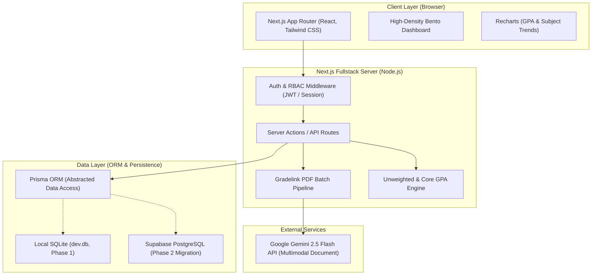
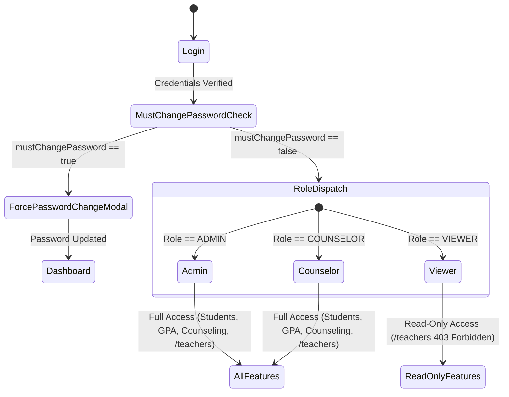
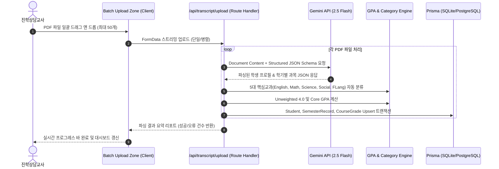

# 등대교육공동체 진학상담포탈 시스템 및 데이터베이스 아키텍처 (Architecture.md)

## 1. 시스템 아키텍처 개요 (System Overview)

등대글로벌스쿨(Lighthouse International School, CEEB: 682019) 대학 진학상담포탈은 고등학교(9~12학년) 진학상담교사 및 관리자가 학생별 학업 성취도(GPA, 표준화 시험), 비교과 활동, 1:1 상담 일지, 목표 대학 포트폴리오를 고밀도 벤토 그리드(Bento Grid) 환경에서 통합 분석하고 지도하기 위한 **100% 교직원 전용(Teacher-Only) 웹 애플리케이션**이다.



---

## 2. 기술 스택 명세 (Technology Stack)

| 구분 | 기술 스택 | 선정 이유 및 가이드라인 |
| :--- | :--- | :--- |
| **Framework** | Next.js 14+ (App Router, TypeScript) | SSR/RSC 기반의 빠른 로딩 속도, Server Actions을 통한 안전한 백엔드 로직 처리 |
| **Styling & UI** | Tailwind CSS, Lucide React, Headless UI | Bento Grid 레이아웃, Academic Deep Navy(`slate-900`/`blue-900`) 테마 적용 |
| **Data Visualization**| Recharts | 학기별 전체 GPA 및 5대 핵심교과(English, Math, Science, Social, FLang) 추이 차트 |
| **ORM** | Prisma ORM 5.x+ | 데이터베이스 드라이버 전환(SQLite ↔ PostgreSQL) 시 스키마 변경 최소화 |
| **Database (Dev)** | SQLite (`file:./dev.db`) | 외부 클라우드 접속 없이 즉시 로컬 구동, 빠른 프로토타이핑 및 테스트 |
| **Database (Prod)**| Supabase (PostgreSQL 15+) | 프로바이더 전환(`provider = "postgresql"`)만으로 무중단 마이그레이션 지원 |
| **Authentication** | Jose / Iron-Session / Custom JWT Cookie | HTTP-only 쿠키 기반 경량 세션 관리, Role-Based Access Control(RBAC) |
| **AI Integration** | Google Gemini API (`@google/genai`) | Gradelink 2단 성적표 PDF 분석, Multimodal Document & Structured JSON Output |

---

## 3. 인증 및 권한 아키텍처 (Authentication & RBAC)

### 3.1 사용자 권한(Role) 정의



1. **Admin (시스템 관리자)**
   * **초기 시드 계정:** `kyumun.hwang@gmail.com` / `emeo1004#`
   * 모든 학생 데이터 조회/생성/수정/삭제
   * Gradelink PDF 일괄 업로드 및 파싱 실행
   * 성적 수동 보정(Credit Make-up) 승인
   * 교사 관리 페이지(`/teachers`) 접근 및 교사 CRUD, 비밀번호 초기화

2. **Counselor (진학상담교사)**
   * **초기 시드 계정:** `ls.counselors@gmail.com` / `1234` (`mustChangePassword: true`)
   * 시스템 최초 로그인 시 `mustChangePassword` 미들웨어에 의해 **비밀번호 변경 모달이 강제 실행**되며, 신규 비밀번호 설정 전까지 대시보드 진입 불가
   * 학생 데이터, 성적 수동 보정, 1:1 상담일지, 목표 대학 리스트 등 상담 포탈의 핵심 기능에 대한 전체 CRUD 권한 보유
   * 교사 관리 페이지(`/teachers`) 접근 및 신규 교사 등록 권한 보유

3. **Viewer (일반/교과 교사)**
   * 학생 대시보드, GPA 추이 그래프, 학기별 성적표, 목표 대학 리스트 **열람(Read-Only)만 허용**
   * 성적 수정, PDF 업로드, 학생 등록/삭제, 상담 일지 작성/수정 권한 없음 (UI 버튼 비활성화 및 백엔드 Guard 처리)
   * **교사 관리 메뉴(`/teachers`) 접근 완전 차단:** 사이드바에 메뉴가 노출되지 않으며, URL 직접 접근 시 `403 Forbidden` 또는 `/dashboard`로 리다이렉트

### 3.2 세션 및 미들웨어 처리 (`middleware.ts`)

```typescript
import { NextResponse } from 'next/server';
import type { NextRequest } from 'next/server';
import { verifySessionToken } from '@/lib/auth/session';

export async function middleware(request: NextRequest) {
  const { pathname } = request.nextUrl;
  
  // Public routes
  if (pathname.startsWith('/login') || pathname.startsWith('/api/auth/login')) {
    return NextResponse.next();
  }

  const session = await verifySessionToken(request);
  if (!session) {
    return NextResponse.redirect(new URL('/login', request.url));
  }

  // Enforce password change
  if (session.mustChangePassword && !pathname.startsWith('/api/auth/change-password')) {
    if (pathname !== '/change-password') {
      return NextResponse.redirect(new URL('/change-password', request.url));
    }
  }

  // Teacher management RBAC guard (/teachers)
  if (pathname.startsWith('/teachers') || pathname.startsWith('/api/teachers')) {
    if (session.role === 'VIEWER') {
      return new NextResponse('Forbidden: Access Denied', { status: 403 });
    }
  }

  return NextResponse.next();
}

export const config = {
  matcher: ['/((?!_next/static|_next/image|favicon.ico).*)'],
};
```

---

## 4. 데이터베이스 아키텍처 및 스키마 설계 (`prisma/schema.prisma`)

SQLite와 Supabase PostgreSQL 양쪽 모두에서 100% 호환되도록 설계되었습니다.
* SQLite에서는 Enum 대신 String으로 매핑되거나 Prisma의 Enum emulation이 적용됩니다.
* 추후 PostgreSQL로 전환 시 `provider = "sqlite"`를 `provider = "postgresql"`로 교체하고 `DATABASE_URL`을 Supabase 연결 문자열로 변경하면 즉시 동작합니다.

```prisma
datasource db {
  provider = "sqlite"
  url      = env("DATABASE_URL")
}

generator client {
  provider = "prisma-client-js"
}

enum Role {
  ADMIN
  COUNSELOR
  VIEWER
}

enum StudentStatus {
  ENROLLED
  LEAVE_OF_ABSENCE
  WITHDRAWAL
  GRADUATED
}

enum SubjectCategory {
  ENGLISH
  MATH
  SCIENCE
  SOCIAL_STUDIES
  FOREIGN_LANGUAGE
  OTHER
}

enum ApplicationType {
  ED
  EA
  REA
  REGULAR
  ROLLING
}

enum AdmissionTier {
  REACH
  MATCH
  SAFETY
}

enum ProposerType {
  TEACHER_RECOMMENDED
  STUDENT_DESIRED
  MUTUAL
}

// ----------------------------------------------------
// 1. User (교사 계정 및 권한)
// ----------------------------------------------------
model User {
  id                 String          @id @default(uuid())
  email              String          @unique
  passwordHash       String
  name               String
  role               Role            @default(VIEWER)
  mustChangePassword Boolean         @default(false)
  lastLoginAt        DateTime?
  createdAt          DateTime        @default(now())
  updatedAt          DateTime        @updatedAt

  counselingLogs     CounselingLog[]
  auditLogs          GradeAuditLog[]

  @@map("users")
}

// ----------------------------------------------------
// 2. Student (학생 기본 인적사항)
// ----------------------------------------------------
model Student {
  id              String             @id @default(uuid())
  studentCode     String             @unique // Gradelink 학번 (예: "1017", "1121")
  nameEn          String             // 영문 이름 (예: "LIM, Gaeun" or "David Kim")
  nameKo          String?            // 한글 이름 (예: "임가은", "김등대")
  gradeLevel      Int                // 현재 학년 (9 ~ 12)
  status          StudentStatus      @default(ENROLLED)
  birthDate       DateTime?
  gender          String?            // "M" or "F"
  entryDate       DateTime?
  graduationDate  DateTime?
  withdrawalDate  DateTime?          // 전출일 (존재 시 WITHDRAWAL 배지)
  parentName      String?
  parentContact   String?
  address         String?

  // Cumulative GPAs (Unweighted 4.0 만점 기준)
  cumulativeGpa       Float          @default(0.0) // 전체 누적 GPA
  coreCumulativeGpa   Float          @default(0.0) // 5대 주요교과 누적 GPA
  cumulativeCredits   Float          @default(0.0) // 총 취득 학점

  createdAt       DateTime           @default(now())
  updatedAt       DateTime           @updatedAt

  semesterRecords   SemesterRecord[]
  standardizedTests StandardizedTest[]
  clubActivities    ClubActivity[]
  awardRecords      AwardRecord[]
  counselingLogs    CounselingLog[]
  targetUniversities TargetUniversity[]

  @@map("students")
}

// ----------------------------------------------------
// 3. SemesterRecord (학기별 성적 레코드)
// ----------------------------------------------------
model SemesterRecord {
  id              String        @id @default(uuid())
  studentId       String
  student         Student       @relation(fields: [studentId], references: [id], onDelete: Cascade)
  academicYear    String        // 예: "2022-2023", "2023-2024"
  termName        String        // 예: "Semester 1", "Semester 2", "Summer Semester 2025"
  gradeLevel      Int           // 이수 당시 학년 (9, 10, 11, 12)
  termGpa         Float         @default(0.0) // 해당 학기 전체 Unweighted GPA
  termCoreGpa     Float         @default(0.0) // 해당 학기 5대 교과 Unweighted GPA
  termCredits     Float         @default(0.0) // 해당 학기 취득 학점

  // Gradelink PDF 원본 표기값 (검증 및 대조용)
  reportedTermGpa Float?
  reportedCumGpa  Float?

  createdAt       DateTime      @default(now())
  updatedAt       DateTime      @updatedAt

  courses         CourseGrade[]

  @@unique([studentId, academicYear, termName])
  @@map("semester_records")
}

// ----------------------------------------------------
// 4. CourseGrade (개별 과목 성적 및 Credit Make-up)
// ----------------------------------------------------
model CourseGrade {
  id                String          @id @default(uuid())
  semesterRecordId  String
  semesterRecord    SemesterRecord  @relation(fields: [semesterRecordId], references: [id], onDelete: Cascade)
  
  courseCode        String?         // 과목 코드 (예: "ENG301")
  courseTitle       String          // 과목명 (예: "AP Calculus AB", "Algebra II (Credit Recovery)")
  category          SubjectCategory @default(OTHER) // 5대 교과 분류
  credits           Float           @default(1.0)   // 이수 학점 (0.5 or 1.0)
  
  // 성적 표기
  originalGrade     String          // Gradelink 원본 알파벳 (예: "A", "B+", "P", "nm")
  originalPercentage Float?         // 원본 백분위 (예: 94.0)
  unweightedGradePoint Float        // 4.0 기준 환산 점수 (A=4.0, A-=3.7, B+=3.3...)

  // Credit Make-up (성적 보정 / 재수강)
  isCreditMakeup    Boolean         @default(false)
  adjustedGrade     String?         // 수정/재수강 반영된 알파벳 성적
  adjustedGradePoint Float?        // 수정된 4.0 환산 점수
  makeupReason      String?         // "Summer School", "Online Course (UC Scout)", "Manual Override"

  includeInGpa      Boolean         @default(true) // P/F 과목이나 nm은 false

  createdAt         DateTime        @default(now())
  updatedAt         DateTime        @updatedAt

  auditLogs         GradeAuditLog[]

  @@map("course_grades")
}

// ----------------------------------------------------
// 5. GradeAuditLog (성적 수정 이력 추적)
// ----------------------------------------------------
model GradeAuditLog {
  id              String      @id @default(uuid())
  courseGradeId   String
  courseGrade     CourseGrade @relation(fields: [courseGradeId], references: [id], onDelete: Cascade)
  changedById     String
  changedBy       User        @relation(fields: [changedById], references: [id])
  previousValue   String      // 이전 성적 및 점수 JSON
  newValue        String      // 변경된 성적 및 점수 JSON
  reason          String
  createdAt       DateTime    @default(now())

  @@map("grade_audit_logs")
}

// ----------------------------------------------------
// 6. StandardizedTest (공인 어학 및 표준화 시험 대표 점수)
// ----------------------------------------------------
model StandardizedTest {
  id              String      @id @default(uuid())
  studentId       String
  student         Student     @relation(fields: [studentId], references: [id], onDelete: Cascade)
  
  testType        String      // "TOEFL", "SAT", "PSAT", "AP"
  totalScore      Float?      // TOEFL (0~120), SAT/PSAT (400~1600)
  testDate        DateTime?   // 응시일자 (YYYY-MM-DD)
  
  // 세부 영역 점수 (JSON 문자열 저장: SQLite 호환)
  // 예: TOEFL -> {"reading": 29, "listening": 29, "speaking": 26, "writing": 28}
  // 예: SAT -> {"ebrw": 740, "math": 780}
  // 예: AP -> {"subject": "AP Calculus BC", "score": 5}
  sectionScoresJson String?
  notes           String?
  isRepresentative Boolean    @default(true) // 대표 점수 여부

  createdAt       DateTime    @default(now())
  updatedAt       DateTime    @updatedAt

  @@map("standardized_tests")
}

// ----------------------------------------------------
// 7. ClubActivity & AwardRecord (비교과 활동)
// ----------------------------------------------------
model ClubActivity {
  id          String   @id @default(uuid())
  studentId   String
  student     Student  @relation(fields: [studentId], references: [id], onDelete: Cascade)
  clubName    String   // 동아리명 (예: "MUN (Model UN)", "Varsity Soccer")
  role        String   // 직책 (예: "President", "Member", "Captain")
  yearsActive String   // 활동 학년 (예: "9, 10, 11")
  description String?  // 활동 내용 요약
  createdAt   DateTime @default(now())
  updatedAt   DateTime @updatedAt

  @@map("club_activities")
}

model AwardRecord {
  id          String    @id @default(uuid())
  studentId   String
  student     Student   @relation(fields: [studentId], references: [id], onDelete: Cascade)
  awardTitle  String    // 수상명 (예: "AMC 12 School Winner")
  awardType   String    @default("INTERNAL") // "INTERNAL" (교내) vs "EXTERNAL" (교외)
  awardDate   DateTime? // 수상일자
  issuer      String?   // 수여 기관
  createdAt   DateTime  @default(now())
  updatedAt   DateTime  @updatedAt

  @@map("award_records")
}

// ----------------------------------------------------
// 8. CounselingLog (1:1 진학상담 일지)
// ----------------------------------------------------
model CounselingLog {
  id          String    @id @default(uuid())
  studentId   String
  student     Student   @relation(fields: [studentId], references: [id], onDelete: Cascade)
  counselorId String
  counselor   User      @relation(fields: [counselorId], references: [id])
  
  counselDate DateTime  @default(now())
  category    String    // "목표대학 선정", "GPA 관리", "공인성적 점검", "에세이/원서", "학부모 상담"
  withParent  Boolean   @default(false)
  title       String    // 상담 요약 제목
  content     String    // 상세 상담 내용 (Markdown/Rich Text)
  actionItems String?   // JSON 형식 체크리스트 [{"id":"1", "task":"AP Cal 유지", "done":true}]
  isConfidential Boolean @default(false)

  createdAt   DateTime  @default(now())
  updatedAt   DateTime  @updatedAt

  @@map("counseling_logs")
}

// ----------------------------------------------------
// 9. TargetUniversity (목표 대학교 리스트)
// ----------------------------------------------------
model TargetUniversity {
  id              String          @id @default(uuid())
  studentId       String
  student         Student         @relation(fields: [studentId], references: [id], onDelete: Cascade)
  
  universityName  String          // 대학명 (예: "Cornell University", "Purdue University")
  location        String?         // 국가/주 (예: "Ithaca, NY, USA")
  major           String?         // 희망 전공 (예: "Computer Science")
  
  proposerType    ProposerType    @default(TEACHER_RECOMMENDED)
  applicationType ApplicationType @default(REGULAR)
  admissionTier   AdmissionTier   @default(MATCH)
  
  pros            String?         // 장점 요약
  cons            String?         // 단점 요약
  counselorNotes  String?         // 진학상담사 전문 코멘트
  resultStatus    String          @default("CONSIDERING") // "CONSIDERING", "APPLIED", "ACCEPTED", "REJECTED", "WAITLISTED"

  createdAt       DateTime        @default(now())
  updatedAt       DateTime        @updatedAt

  @@map("target_universities")
}
```

---

## 5. Gradelink PDF Batch Parsing 파이프라인

등대글로벌스쿨 성적표(Gradelink Official Transcript)는 2단 다단 레이아웃, 외부 학점(APEX, UC Scout), 계절학기, 전출생의 표기 예외 등 파싱 난이도가 높습니다. 본 시스템은 Google Gemini 2.5 Flash Multimodal Document Understanding과 Structured Outputs(`responseSchema`)를 결합하여 100% 정형화된 JSON을 추출합니다.



### 5.1 Gemini API 프롬프트 및 추출 스키마
Gemini Document Parsing은 텍스트 인코딩 왜곡이나 표 밀림에 구애받지 않고 시각적 좌표와 레이아웃 구조를 직접 인지하여 다음 데이터를 보장 추출합니다:
1. **학생 인적사항:** Student ID(학번 4자리), Full Name(영문 성/이름), Birth Date, Entry Date, Graduation Date, Withdrawal Date.
2. **학기 정보:** 학년도(Academic Year, 예: `2023-2024`), 학기명(Term Name, 예: `Semester 1`), 이수 당시 학년(Grade Level).
3. **과목 리스트:** Class Title(과목명), Credits(학점), Letter Grade(A+, A, B- 등), Percentage(백분위 점수).

### 5.2 5대 핵심 교과 자동 분류 사전
추출된 `Class Title`은 사전 정의된 정규식 및 키워드 사전을 통해 5대 카테고리로 분류됩니다:
* `ENGLISH`: English I~IV, Honors, Great Books, Creative Writing, Reading Skills.
* `MATH`: Geometry, Algebra I~II, AP Precalculus, AP Calculus AB/BC, Statistics.
* `SCIENCE`: Biology, Chemistry, Physics, AP Bio, AP Chem, AP Physics.
* `SOCIAL_STUDIES`: Korean History, Modern World History, US History, AP US History, AP Psychology.
* `FOREIGN_LANGUAGE`: Chinese I~III, AP Chinese.
* `OTHER`: Bible, Seminar, PE, Art, Music, Computer Science, Yearbook.

---

## 6. Unweighted GPA & Core GPA 재계산 엔진

등대글로벌스쿨 진학상담포탈의 GPA 계산은 **가중치 없는 4.0 만점 기준(Unweighted 4.0 Scale)**만 지원합니다.

### 6.1 알파벳 성적 환산 기준표 (Unweighted Scale)

$$\text{GradePoint}(G) = \begin{cases}
4.0 & (A+, A) \\
3.7 & (A-) \\
3.3 & (B+) \\
3.0 & (B) \\
2.7 & (B-) \\
2.3 & (C+) \\
2.0 & (C) \\
1.7 & (C-) \\
1.3 & (D+) \\
1.0 & (D) \\
0.7 & (D-) \\
0.0 & (F)
\end{cases}$$

*(P/F 과목이나 'nm', 'N/A' 등 미이수 표기는 취득 학점 및 평점 계산에서 제외)*

### 6.2 계산 수식
1. **학기별 전체 Unweighted GPA:**
   $$\text{Term GPA} = \frac{\sum_{i \in \text{All Courses}} (\text{Credits}_i \times \text{GradePoint}_i)}{\sum_{i \in \text{All Courses}} \text{Credits}_i}$$

2. **학기별 5대 핵심 Core GPA:**
   $$\text{Term Core GPA} = \frac{\sum_{i \in \text{Core Courses}} (\text{Credits}_i \times \text{GradePoint}_i)}{\sum_{i \in \text{Core Courses}} \text{Credits}_i}$$
   *(Core Courses: Category가 ENGLISH, MATH, SCIENCE, SOCIAL_STUDIES, FOREIGN_LANGUAGE인 과목)*

3. **Credit Make-up 반영:**
   과목에 `isCreditMakeup = true`가 적용된 경우, `originalGradePoint` 대신 `adjustedGradePoint`를 우선 사용하여 전체 및 Core GPA가 즉시 재계산됩니다.
